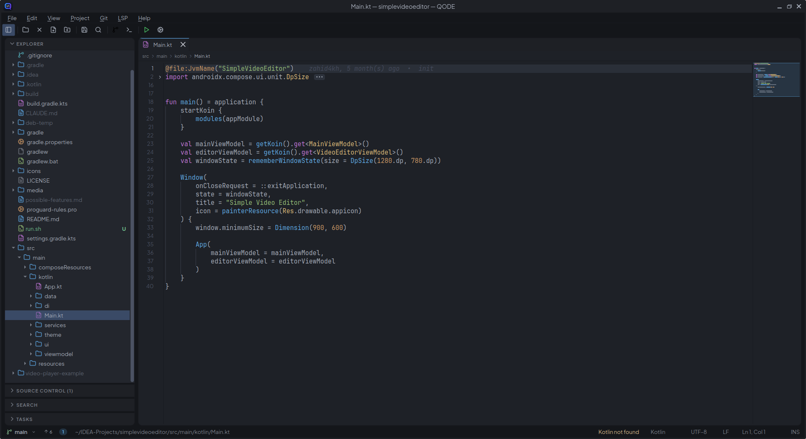
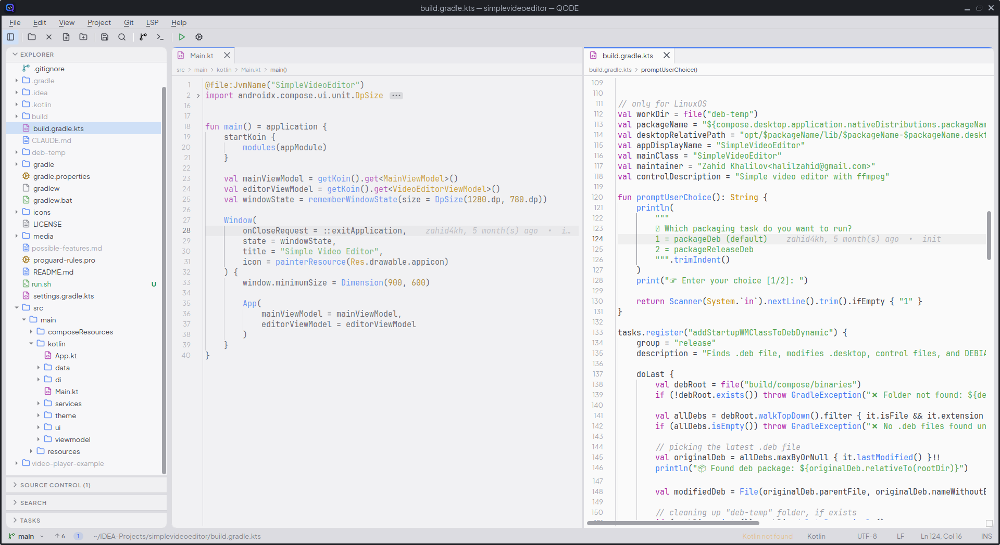
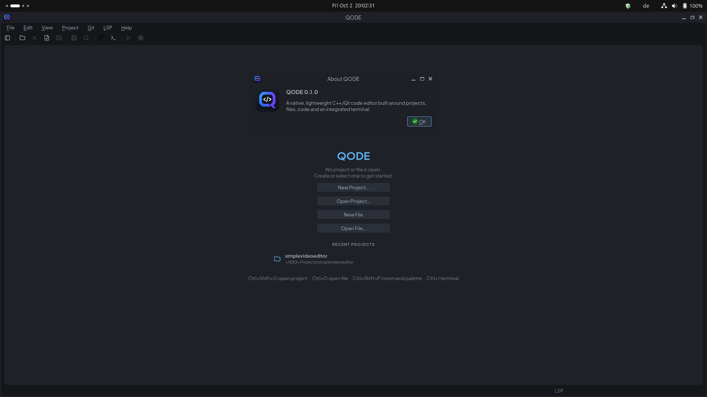

# QODE

A native C++/Qt 6 code editor for Linux and Windows with a coding chat built in. QODE opens on the welcome page; the **QODE chat** (Gemini or Claude) is the main view and the editor opens beside it when you open files. Around it: project explorer, tabbed syntax-highlighted editor with split groups, language servers, git, an integrated terminal (`Ctrl+J`), a debugger for Java / Kotlin and run tooling for JVM, web, Expo and Python projects.

## Features

- **QODE chat** (`Ctrl+Alt+G`): works in your project with tools for files, search, the terminal, language servers, git and the debugger. It checks the diagnostics after each edit, shows token use and cost, can search the codebase by meaning, and every change can be undone or redone from the chat. Slash commands, MCP servers, and **Fix with QODE** on a failed terminal command, a failing test or an error in Tasks > Problems.
- **Inline edit** (`Ctrl+K`): ask for a change in the editor, watch the proposal stream into the text, then Accept or Reject.
- **Claude Code view** (`Ctrl+Alt+C`): a graphical front end for the `claude` CLI, with install check, sign-in, permission prompts as cards, conversation history, `/usage` and `/mcp`.
- **Editor**: multiple cursors, folding, code lenses (▶ Run / Debug over tests and mains), Ctrl+click links, `.editorconfig`, local history (versions on save, diff and restore), bookmarks, CSV table, Markdown and media preview, Copy as Image. For C / C++: Switch Header/Source, `#include` completion and Generate Definition.
- **Language servers**: diagnostics, hover, completion, Go to Definition, call / type hierarchy and quick fixes (see below).
- **JVM**: Gradle tasks, the Maven panel, Spring Boot and Ktor (server bar, routes, requests), a JDWP debugger (breakpoints, steps, variables), New Kotlin / Java class, and a dependency manager backed by Maven Central.
- **Web, Expo and Python**: dev server strip, `.env` editor, a live web / Expo preview (phone and tablet mockups), Python venvs and packages.
- **HTTP client** for `.http` / `.rest` files, with variables, environments and chained requests.
- **Git**: Version Control panel with a diff pane and inline blame.
- **Game panel** (`Ctrl+Alt+P`): a neon block-stacking game beside the chat, for while QODE or Claude Code works. It pauses when you click away, and keeps your high score, top 10 and play time.

QODE never writes into your project folder. **Help > QODE's Files** lists everything it has created on your computer, with sizes.

| | Linux | Windows |
| --- | --- | --- |
| Settings, keys, per-project data | `~/.config/QODE-AGENTIC` | `%APPDATA%\QODE-AGENTIC` |
| Downloads (language servers, local history) | `~/.local/share/QODE-AGENTIC` | `%LOCALAPPDATA%\QODE-AGENTIC` |
| Caches | `~/.cache/QODE-AGENTIC` | `%LOCALAPPDATA%\QODE-AGENTIC\cache` |

The Windows portable zip keeps all of it in a `data` folder next to `qode.exe` instead.

## QODE chat: API keys

The chat runs on **Gemini** or **Claude** with your own API key. Click the key button in the chat header (**Set API key…**) to save one. QODE stores it in a file only you can read (mode 0600 on Linux; on Windows it sits in your own profile under `%APPDATA%`, protected by the profile's permissions). It also picks up `GEMINI_API_KEY` / `ANTHROPIC_API_KEY` from the environment or from a `.env.local` / `.env` file. Keys are never put into prompts, and secret files (`.env*`, keys, credentials) are never sent to the model.

The Claude Code view needs the [`claude` CLI](https://docs.anthropic.com/en/docs/claude-code); the view checks for it and helps you install it and sign in. On Windows, Claude Code also needs [Git for Windows](https://git-scm.com/download/win) (it runs its commands in Git Bash).

## Screenshots



*Editor with project explorer, breadcrumbs, code folding, minimap and inline git blame.*



*Split editor: files side by side, each with its own tabs and breadcrumbs.*



*Welcome page with quick actions and recent projects.*

## Install

### Linux: Debian / Ubuntu (APT)

QODE is published in a personal APT repository (amd64), so it installs and updates like any other package:

```sh
# 1. Trust the repository's signing key
wget -qO- https://zahid4kh.github.io/my-apt-repo/KEY.gpg | sudo gpg --dearmor -o /usr/share/keyrings/zahid-archive-keyring.gpg

# 2. Add the repository
echo "deb [arch=amd64 signed-by=/usr/share/keyrings/zahid-archive-keyring.gpg] https://zahid4kh.github.io/my-apt-repo stable main" | sudo tee /etc/apt/sources.list.d/zahid-apps.list

# 3. Update the package list and install
sudo apt update
sudo apt install qode                  # uses the system's Qt 6 packages
# or
sudo apt install qode-bundled          # ships its own Qt 6.11 (with Qt WebEngine) in /opt/qode
# or
sudo apt install qode-bundled-noweb    # the same without Qt WebEngine: smaller, no web / Expo preview
```

The first step downloads the key and stores it in the system keyring, the second tells APT where the packages live and which key signs them, and the third installs QODE. Later releases arrive through `sudo apt update && sudo apt upgrade`.

There are three packages, and only one can be installed at a time. Installing one replaces the other, and your settings and data are kept when you switch:

- **`qode`** depends on the distro's Qt 6 packages (Qt 6.4 or newer). It is small and shares Qt with other apps. If the distro has Qt WebEngine, the web preview is included.
- **`qode-bundled`** carries its own Qt 6.11 in `/opt/qode`, including Qt WebEngine (a recent Chromium) for the web / Expo preview. It needs no Qt packages and is not affected by the system's Qt version.
- **`qode-bundled-noweb`** is `qode-bundled` without Qt WebEngine. It has no embedded web / Expo preview (pages open in your browser) and is a much smaller download.

The bundled packages need the same or a newer glibc than the machine they were built on. After installing, the package prints which version and flavour you got and what is new in it.

The `.deb` files are also attached to each [GitHub release](https://github.com/zahid4kh/QODE/releases), e.g. `sudo apt install ./qode_<version>_amd64.deb`. To build from source instead, see below.

### Windows

Windows 10 (1809) or newer, x64. Each [GitHub release](https://github.com/zahid4kh/QODE/releases) has two flavours, each as an installer and a portable zip:

- **`QODE-<version>-setup.exe`**, with Qt WebEngine for the web / Expo preview.
- **`QODE-<version>-noweb-setup.exe`**, the same without Qt WebEngine: smaller, pages open in your browser.
- **`QODE-<version>[-noweb]-portable.zip`**: unzip anywhere and run `QODE\qode.exe`. Settings and data stay in the unzipped folder.

The installer needs no administrator rights: it installs for your user only, into `%LOCALAPPDATA%\Programs\QODE`, and QODE writes nothing to the registry. Installing one flavour replaces the other and keeps your settings. The uninstaller lists QODE's data with sizes and lets you choose what to delete.

The installer is not code-signed yet, so Windows SmartScreen may warn about an unknown publisher. Choose **More info > Run anyway**, or check the file against the SHA-256 listed in the release first.

In QODE's terminal you can pick PowerShell 7, Windows PowerShell, Command Prompt, Git Bash or WSL (when a distribution is installed). Commands QODE types for you (run configurations, Gradle, npm) are rewritten for the shell you use.

## Build

Requires Qt 6.4 or newer (Core, Gui, Widgets, Network), qmake6, zlib and a C++17 compiler. Optional modules are used when present: Qt WebEngine (web / Expo preview), Qt Multimedia (video in the media panel) and Qt DBus (desktop notifications, Linux). [CONTRIBUTING.md](CONTRIBUTING.md) has more detail.

### Linux

```sh
mkdir build && cd build
qmake6 ../QODE.pro       # add CONFIG+=no_webengine to leave the web preview out
make -j$(nproc)
./qode [project-dir | file ...]
sudo make install        # optional, PREFIX defaults to /usr/local
```

`scripts/compile.sh` does the same and picks the newest Qt under `~/Qt` when there is one.

### Windows

Install Qt 6 for MSVC (the `msvc2022_64` kit; add Qt WebEngine and Qt Multimedia for the preview and video) and Visual Studio 2022 or newer with the C++ workload. Then, in a Command Prompt:

```bat
set QODE_QT_ROOT=C:\Qt
scripts\win\compile.bat
```

`QODE_QT_ROOT` is the folder that holds `6.x\msvc2022_64`. The script finds Visual Studio by itself, builds into `build-win\` and copies the Qt DLLs next to `qode.exe` (`build-win\qode.exe` or `build-win\release\qode.exe`), so it starts with a double-click. Use `compile.bat noweb` to build without Qt WebEngine, and `scripts\win\build-installer.ps1` to make the installer and the portable zip (needs Inno Setup 6).

## Language servers (LSP)

QODE is an LSP client; it does not ship any language server (for Kotlin and the web languages it can download one for you on request). Install the server for your language and QODE finds it on `PATH` (or use **LSP > Set Server Path…**). With no server installed everything else works as before, and the status bar shows a hint when you open a file that has one available.

| Language | Server | Install |
|---|---|---|
| C / C++ | [clangd](https://clangd.llvm.org) | Linux: `sudo apt install clangd` · `sudo dnf install clang-tools-extra` · `sudo pacman -S clang`. Windows: `winget install LLVM.LLVM`, or MSYS2's `clang-tools-extra` (both folders are found without changing PATH) |
| Kotlin | [kotlin-lsp](https://github.com/Kotlin/kotlin-lsp) (JetBrains, Alpha) | **LSP > Download and Set Up…** (see below) |
| JavaScript / TypeScript (`.js .jsx .mjs .cjs .ts .tsx .mts .cts`) | [typescript-language-server](https://github.com/typescript-language-server/typescript-language-server) | **LSP > Download and Set Up…** (see Web development) |
| HTML | vscode-html-language-server | same install |
| CSS / SCSS / Less | vscode-css-language-server | same install |
| JSON / JSONC | vscode-json-language-server | same install |

clangd needs to know your compiler flags: put a `compile_commands.json` (CMake: `-DCMAKE_EXPORT_COMPILE_COMMANDS=ON`; Makefile/qmake projects: `bear -- make`) or a `compile_flags.txt` in the project root or its `build/` folder. Without one clangd guesses default flags (fine for plain files) and may report false errors for project or library headers; in that case use **LSP > Project Compiler Flags…** to give QODE the flags (`-I...`, `-D...`, `-std=...`; there is an "Add Qt 6 Flags" button). They are stored in QODE's settings, not in your project.

**qmake projects** need nothing extra: if the project folder has a `.pro` file, QODE reads it (`QT`, `CONFIG += c++NN`, `INCLUDEPATH`, `DEFINES`, `PKGCONFIG`, `include()`, `SUBDIRS`, and the common platform/Qt-version conditions) and gives clangd the include paths, defines and Qt module headers itself. Saving the `.pro` refreshes them. Flags you add in **Project Compiler Flags…** come after the detected ones.

Currently supported: diagnostics (squiggles, tinted line numbers, error/warning counts in the status bar), hover (rest the mouse on a symbol for its type and documentation) and **Go to Definition** (F12 or Ctrl+click; holding Ctrl underlines the symbol under the mouse like a link; several candidates are offered in a menu) and **code completion** (a popup appears as you type or after `.`, `->`, `::`; Up/Down to choose, Tab or Enter to accept, Esc to dismiss, Ctrl+Space to open it manually; accepting a symbol from a header you have not included adds the `#include`). Without a server, Ctrl+Space completes from words in the current file.

**Kotlin**: choose **LSP > Download and Set Up…** (also shown when you open a `.kt` file without a server). QODE downloads JetBrains' standalone archive for your OS (about 370 MB, SHA-256 verified) from download.jetbrains.com, unpacks it into QODE's data folder (`lsp/kotlin`), links it as `~/.local/bin/kotlin-lsp` (on Windows `%USERPROFILE%\.local\bin\kotlin-lsp.cmd`) and test-runs it. No Java install is needed (the server brings its own runtime) and no administrator rights are used. The dialog installs the tested version; tick the box there for the latest release. The **LSP** menu has one submenu per server (status, set up, restart, log, remove): **Update / Reinstall…** manages the download later, and **Remove Language Server…** shows and runs the removal (for Kotlin it deletes the download, link and caches with a visible log; for clangd it gives the `apt` / `dnf` / `pacman` command, or `winget` / MSYS2 on Windows, to run in QODE's terminal) and then offers to restart QODE. To do it by hand, take the *standalone* `kotlin-server-<version>.tar.gz` (Windows: `kotlin-server-<version>.win.zip`) from the [releases page](https://github.com/Kotlin/kotlin-lsp/releases) (not the `.vsix`, that is the VS Code extension), unpack it and put `bin/intellij-server` on your `PATH` as `kotlin-lsp`, or use **LSP > Set Server Path…**. Go to Definition on a library symbol opens its source (unpacked read-only from the dependency's `-sources.jar` or the JDK's `src.zip`), unused imports turn gray (hover one to remove them, choosing which in a dialog), import lists fold with a chevron on the first import, **Alt+Enter** offers quick fixes such as *Import → java.io.File*, and accepting a completion for a class you have not imported adds the `import` line for you. The server analyses Gradle and Maven projects (a `build.gradle(.kts)` / `pom.xml` in the project folder); the first import can take a while and its progress shows in the status bar.

**Run** in a qmake application project: the first time you press Run on a C++ source, QODE suggests a command that configures, builds in `build/` and starts the program (`cd {project} && mkdir -p build && cd build && qmake6 ../app.pro && make -j$(nproc) && ./app`); edit it in the Run Configuration dialog if you build differently. On Windows the suggested command is a small `.bat` that sets up MSVC (or MinGW) for the Qt kit QODE found, then runs qmake and the build.

## Web development

**Language servers.** Open any HTML, CSS, JavaScript, TypeScript or JSON file and choose **LSP > Download and Set Up…** (or the hint in the status bar). QODE runs `npm install` into QODE's data folder (`lsp/web`; TypeScript 6, typescript-language-server, vscode-langservers-extracted), so nothing is installed globally and nothing is written into your project; the four servers are installed, updated and removed together. It needs a system **Node.js** (22 or newer; nvm, fnm, volta and asdf installs are found even when QODE is started from a desktop launcher, and on Windows the Node.js installer, winget, Volta and Scoop folders too). You get diagnostics, hover, Go to Definition and completion; a TypeScript copy in the project's `node_modules` is preferred over the managed one. Emmet, Tailwind and similar extras are not included.

**Dev server.** When the project folder (or a subfolder, see below) has a `package.json` with a `dev`, `develop`, `start`, `serve` or `preview` script, the toolbar's Run buttons are replaced by a server strip: a status dot (amber starting, green running, red failed), the address (click to open in the browser), Start/Stop, Restart, Log, `.env` and Settings buttons. **F5** starts or restarts the server instead of running a file.

- **Right command per project:** the package manager comes from the lockfile (`bun.lock`/`bun.lockb` → `bun dev`, `pnpm-lock.yaml` → `pnpm dev`, `yarn.lock` → `yarn dev`, `package-lock.json` → `npm run dev`, else the `packageManager` field, else npm). Next.js, Vite, Nuxt, SvelteKit, Astro, Remix, React Router, Gatsby, Angular, Create React App, Vue CLI, webpack-dev-server, Parcel and Expo are recognised.
- **Port:** the real port is read from the server's output, so it is right even when the server picks another one. **Settings** lets you set a port (passed with the framework's own flag and as `$PORT`), pick another script or package manager, or enter a custom command.
- **Hardcoded ports are never overridden:** a script that pins its port (`next dev -p 4000`, `--port=3000`, `PORT=3000 …`) runs as written and QODE just shows that port. Ports in Vite/Nuxt/Astro/webpack configs, `angular.json` and `.env` files are only reported in the settings.
- **Nested projects:** if the root has no web project but a subfolder does (for example `docs/`; two levels are scanned), QODE asks "Detected a web project at …, run the server?" with *Run Server*, *Not Now* and *Don't Ask Again*. The choice is stored per project.
- **`.env` editor:** the key button edits `.env`, `.env.local` and any other `.env*` file next to the project's `package.json` as a name/value table, or opens the file in the editor. Saving rewrites only the entries you changed, added or removed, so comments, blank lines, `export` prefixes and untouched lines stay byte-identical, and values are quoted only when needed. It can restart the running server afterwards.

The server runs in its own process group (a Job Object on Windows) and is stopped when you switch or close the project and when QODE exits. Per-project choices are kept in QODE's settings, not in your project.

**Explorer.** Entries are ordered folders, dot folders, dot files, then files (each alphabetical). **View > Appearance > Show Hidden Files in Explorer** hides dot files and folders; `.env*` files always stay visible.

## Privacy

This program will not transfer any information to other networked systems unless specifically requested by the user or the person installing or operating it. In detail:

- **QODE chat and inline edit** send your messages and the code they need to the provider you choose (Google Gemini or Anthropic Claude), with your own API key. Nothing is sent until you use them, and nothing at all without a key.
- **Codebase search by meaning:** once you have saved a Gemini key, the chat's codebase index sends the open project's code sections (never secret files) to Google's embedding API, then only new or changed sections. Turn it off in the chat header's index menu (**Search by meaning with Gemini embeddings**); search then ranks by keywords and nothing leaves your computer.
- **Downloads you start:** language servers, JDKs, Gradle and Maven wrappers, npm and Python packages, and searches of Maven Central and PyPI go to those projects' own servers.
- **Claude Code view:** runs the `claude` CLI you installed; it talks to Anthropic under Anthropic's terms.

QODE has no telemetry, no analytics and no update check.

## Contributing

Bug reports and pull requests are welcome. See [CONTRIBUTING.md](CONTRIBUTING.md) for how to build, test and submit a change, and [dev-docs/](dev-docs/) for notes on each part of the code.

## License

QODE is released under the [MIT License](LICENSE). Fonts, icons, logos and the bundled Qt libraries come under their own licenses: see [THIRD_PARTY_NOTICES.md](THIRD_PARTY_NOTICES.md).
